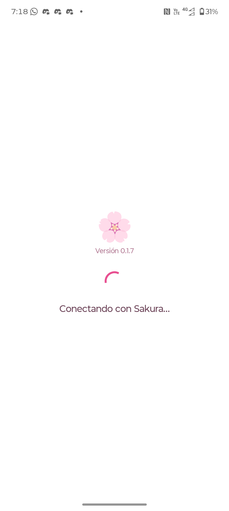
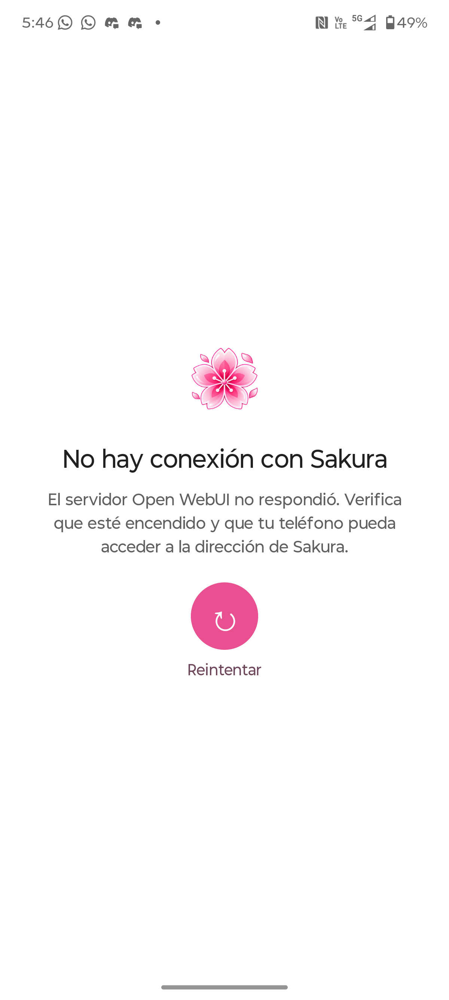
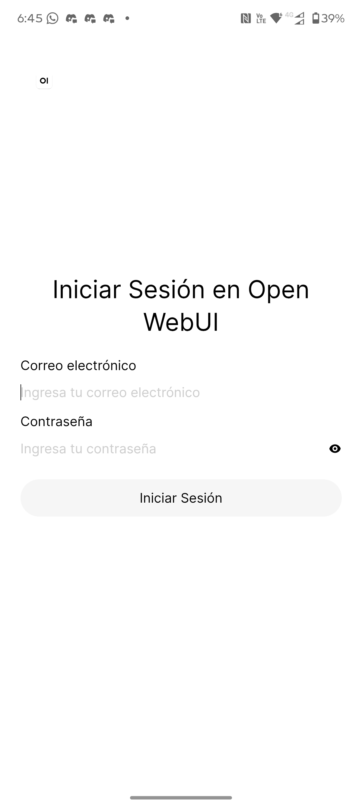
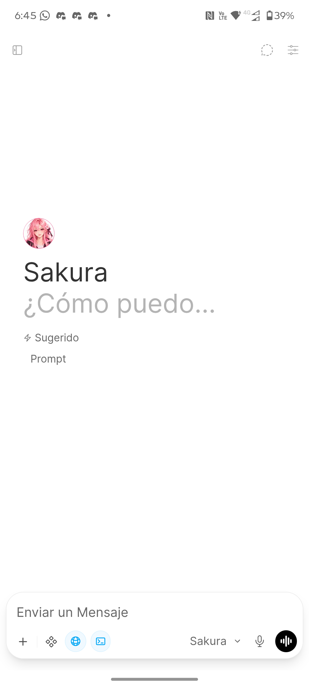
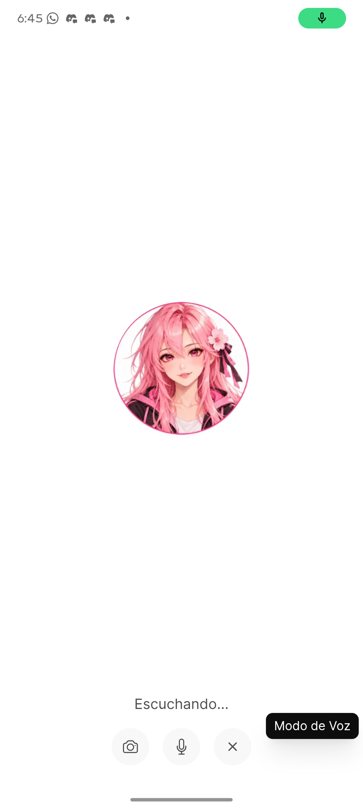
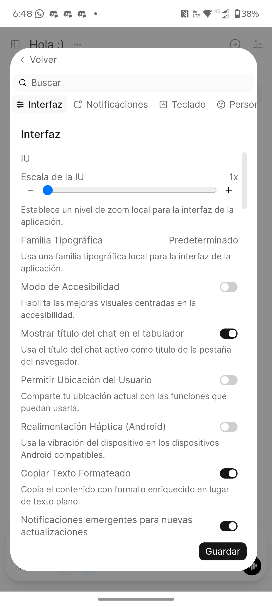
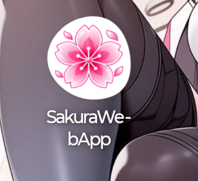

# 🌸 SakuraWebApp 📱 v0.1.7

## ¿Qué es SakuraWebApp?

SakuraWebApp es una app para Android que mejora la experiencia de Open WebUI en el teléfono y lo abre dentro de la propia app. Open WebUI sigue funcionando en tu computadora o servidor; SakuraWebApp es la forma de usarlo desde el teléfono. Mientras Android mantenga la app abierta en segundo plano, conserva la sesión y el lugar donde estabas. Si Android la cierra para liberar memoria, la app vuelve a cargar la página al abrirla. Si no puede conectarse al servidor, muestra un aviso de que no hay conexión y ofrece volver a intentar.

## ¿Qué problema resuelve?

Si abres Open WebUI en Chrome y cambias a otra app, el teléfono puede cerrar esa pestaña para ahorrar memoria. Al regresar, Chrome puede cargar la página otra vez y hacerte perder el punto exacto donde estabas trabajando o tener que volver a buscar la conversación. Esto no borra el chat guardado en el servidor, pero interrumpe la continuidad de la actividad. Además, para que el micrófono, la selección de archivos y el teclado funcionen bien dentro de una app, Android necesita que esas funciones estén conectadas correctamente con la página.

SakuraWebApp adapta Open WebUI para usarlo desde una app instalada en Android. Lo abre en una ventana interna y conecta con funciones del teléfono como el teclado, el micrófono, el audio y el selector de archivos e imágenes. Al iniciar muestra la flor y la versión mientras carga. Si no logra conectar con el servidor, enseña un mensaje con un botón para volver a intentarlo.

## Objetivo general

Compartir un ejemplo completo y una guía clara para que otras personas puedan conectar su propia instalación de Open WebUI y crear una app Android para usarla en sus teléfonos. Cada persona puede adaptar la dirección de su servidor, sus certificados y las funciones de voz que prefiera.

## ✨ Qué incluye

- Open WebUI se abre dentro de la app Android, que permite volver atrás y conserva la sesión mientras Android la mantenga activa.
- Pantallas de carga y de error de conexión con opción para reintentar.
- Al tocar **Subir Archivos**, se abre el selector del sistema Android para elegir uno o varios archivos o imágenes.
- Compatibilidad con el teclado de Android: la pantalla se reajusta para mantener visible el cuadro de mensaje y sus controles.
- Permisos de micrófono y audio gestionados por Android y WebView.
- Icono de Sakura sobre fondo transparente; el arte original está en [assets/sakura-original.png](assets/sakura-original.png).
- **TTS opcional:** Qwen3-TTS Fast es el proveedor usado en esta instalación de ejemplo. No es requisito; puedes configurar otro proveedor de texto a voz compatible con tu instancia de Open WebUI, o no usar TTS.

<div align="center">
  
</div>

## 💡 Ideas para futuras versiones

- Mostrar una notificación de Android cuando Sakura termine de responder mientras estás usando otra app. Al tocarla, volver al chat correspondiente.

## 🖼️ Capturas

Las capturas muestran la animación de inicio mientras conecta, la pantalla de error si el servidor no responde, el inicio de sesión, la pantalla principal, el modo de voz, los ajustes de Open WebUI y el icono instalado en Android.

<details>
<summary>Ver capturas de SakuraWebApp</summary>

| Cargando Open WebUI | Sin conexión |
|:--:|:--:|
|  |  |

| Iniciar sesión | Pantalla principal |
|:--:|:--:|
|  |  |

| Modo de voz | Ajustes de interfaz |
|:--:|:--:|
|  |  |

| Icono en el lanzador |
|:--:|
|  |

</details>

## 📦 Versiones documentadas

- App: SakuraWebApp **0.1.7** (versionCode 18).
- Open WebUI: **0.12.3**, versión verificada en la instalación local.
- Nombre visible del modelo en Open WebUI: **Sakura**. Los registros identifican **llama.cpp 0.7.0-dev**, compilado para x64 con CUDA desde el commit `ea0c4c2c8`, que carga `SoAIHQ/Qwen3.5-9B-GGUF:Q4_K_M` (Qwen 3.5 de 9B, cuantización Q4_K_M). llama.cpp es el servidor de inferencia; el modelo no pertenece a la familia Llama. El alias Sakura se configura en Open WebUI.
- Voz de ejemplo (opcional): Qwen3-TTS Fast compatible con API de OpenAI, modelo **qwen3-tts-clone-0.6b**, puerto local **5052**. Puedes usar otro TTS compatible o no configurar voz.
- Android de referencia: Android 16 (API 36). La app declara minSdk 23 (Android 6.0), targetSdk 36 (Android 16) y compileSdk 37 (Android 17/API 37). compileSdk es la plataforma usada al compilar; no significa que el teléfono necesite Android 17.
- Herramientas fijadas en el proyecto: Android Gradle Plugin 9.4.1, Gradle 9.6.0, Kotlin 2.2.10 y JDK 17 para ejecutar Gradle. El código Java usa compatibilidad de lenguaje 11.
- La activación por palabra “Oye, Sakura” queda como idea futura; no está implementada.

## 🚀 Pasos para usar o adaptar el proyecto

1. Prepara una instancia de Open WebUI y confirma que el teléfono pueda abrirla en la red.
2. Configura HTTPS y un certificado confiable para el host que usarás. La guía explica cómo trabajar con una CA local.
3. Clona este repositorio y compila la app con la URL de tu servidor.
4. Instala el APK en Android y concede el permiso de micrófono si usarás voz.
5. Configura el TTS que prefieras dentro de Open WebUI si quieres respuestas habladas. No necesitas instalar el servidor Qwen de este ejemplo.

Las guías detallan la instalación del servidor, las variables, los certificados, la URL que hay que cambiar, los permisos y los problemas de carga de archivos:

- [Configuración de Open WebUI y TTS](docs/OPENWEBUI.md)
- [HTTPS y certificados](docs/HTTPS.md)
- [Implementación Android, ícono, permisos, archivos y capturas](docs/ANDROID.md)

## 🛠️ Compilar

### Requisitos y versiones de Android

Instala Android Studio compatible con Android Gradle Plugin 9.4.1, Android SDK Platform API 37.0 y JDK 17. El proyecto usa Gradle 9.6.0 mediante el wrapper incluido, así que no necesitas instalar Gradle por separado. No hace falta instalar todas las plataformas que aparecen en SDK Manager. La configuración del proyecto solicita `compileSdk { version = release(37) }`; API 37.0 es la plataforma base requerida. La entrada API 37.1 que aparece en tu SDK Manager es una extensión opcional y no está fijada por el proyecto. En Android Studio puedes revisar el JDK en **Settings → Build, Execution, Deployment → Build Tools → Gradle → Gradle JDK**.

| Ajuste | Valor | Qué significa |
|---|---|---|
| Android mínimo | API 23 / Android 6.0 | Versión mínima para instalar la app |
| Android objetivo | API 36 / Android 16 | Comportamientos de Android para los que está configurada |
| SDK de compilación | API 37 / Android 17 | Plataforma necesaria para compilar; no es requisito para el teléfono |
| Versión de SakuraWebApp | 0.1.7 (versionCode 18) | Versión del APK de este repositorio |

La versión de Android de tu teléfono es independiente del SDK de compilación. En el dispositivo Android 16 de referencia, la app funciona con target API 36.

### Comando exacto para compilar

Desde Android Studio abre la carpeta raíz del proyecto. En la terminal integrada de Android Studio, desde esa carpeta, ejecuta:

```powershell
.\gradlew.bat assembleDebug -PSAKURA_WEBUI_URL="https://<IP-o-host-del-servidor>:8081/"
```

El host es el equipo que ejecuta Open WebUI, no el teléfono. Usa una dirección que el teléfono pueda alcanzar por Wi-Fi o VPN. Una IP privada de la red local no es accesible por datos móviles sin una ruta o VPN configurada.

Si Android SDK Platform API 37.0 no está instalado, abre **Tools → SDK Manager → SDK Platforms** e instala Android 17 / API 37.0. No necesitas marcar todas las versiones ni instalar API 37.1 para este proyecto. Después vuelve a ejecutar el comando. El APK de depuración queda en `app/build/outputs/apk/debug/app-debug.apk` (si Gradle aplica `archivesBaseName`, el nombre puede variar). En Android Studio también puedes usar **Build → Build Bundle(s) / APK(s) → Build APK(s)**; al terminar, pulsa el enlace **locate** del aviso para abrir la carpeta.

Instala una actualización encima de la app existente para conservar los datos locales; desinstalarla puede borrar la sesión del WebView. La compilación debug no es un APK firmado para Google Play.

## 🔐 Privacidad

Este repositorio contiene el código Android, capturas de la app y documentación. No contiene el APK generado, perfiles o bases de datos de Open WebUI, claves secretas, certificados TLS privados ni la CA local de una instalación. No subas `local.properties`, `data/`, bases de datos, `.webui_secret_key`, archivos `.key`, directorios TLS, APKs o certificados privados. La CA pública de una instalación local se agrega solo al build local cuando haga falta; ver [HTTPS.md](docs/HTTPS.md).
